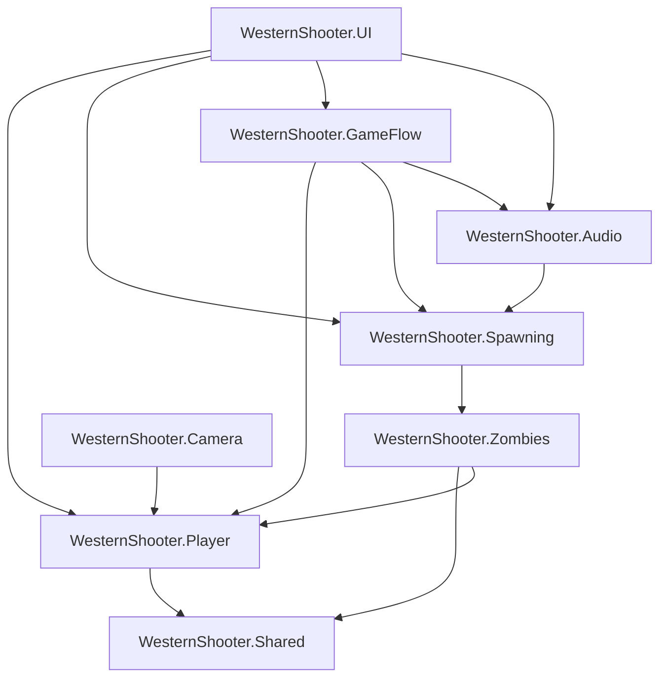

[English](README.md) · **Español**

# 🤠 WesternShooter


<!-- TODO: agregar los badges de plataforma y licencia cuando estén definidos -->

**Prototipo de shooter western en tercera persona, hecho para explorar el audio interactivo en Unity.**

<!-- TODO: reemplazar por un GIF real de gameplay -->


<!-- TODO: descomentar cuando exista la página de itch.io
[**▶ Jugar / ⬇ Descargar en itch.io**](https://emiliano-bazan-zapata.itch.io/...)
-->

---

## Sobre el juego

El jugador recorre un pueblo western estilizado, entra en una zona de búsqueda y enfrenta zombies con un revólver. Se gana al eliminar 3 zombies y se pierde cuando la vida llega a cero.

El gameplay es compacto a propósito. Su función es sostener el objetivo principal del proyecto: una mezcla de audio que reacciona a lo que pasa en el juego, con música adaptativa, snapshots del mixer, ambientes espaciales y voces.

Después del trabajo de audio, el código pasó por una refactorización modular en ocho módulos con límites reforzados por el compilador.

## Características

**Gameplay**

- Movimiento en tercera persona relativo a la cámara, con correr, apuntar y cambio de hombro.
- Combate con revólver que requiere apuntar, con proyectiles físicos.
- Zombies con NavMesh y estados de persecución, ataque y muerte.
- Spawn activado por trigger, con gestión de población y respawn.
- HUD de vida y bajas, más pantallas de menú principal, pausa, opciones, victoria y derrota.

**Audio**

- Audio Mixer con grupos independientes de Música, SFX, Voz y Ambiente, cada uno con su control de volumen.
- Snapshots del mixer según el gameplay: exploración, combate y voz del personaje.
- Música adaptativa con crossfade entre exploración y combate, y temas propios para victoria y derrota.
- Voces asociadas a lugares: banco, hotel, sheriff, saloon y otros edificios.
- Pasos espaciales, ambientes, una campana de iglesia periódica y un tren con escapes de vapor.

## Controles

| Acción           | Teclado / Mouse                 | Gamepad                    |
| ---------------- | ------------------------------- | -------------------------- |
| Moverse          | `W` `A` `S` `D`                 | Stick izquierdo            |
| Mirar            | Mouse                           | Stick derecho              |
| Correr           | `Shift`                         | Presionar stick izquierdo  |
| Apuntar          | Mantener botón derecho          | Mantener gatillo izquierdo |
| Disparar         | Botón izquierdo, apuntando      | Gatillo derecho, apuntando |
| Cambiar de hombro | `Q`                            | Presionar stick derecho    |
| Pausa            | `Esc`                           | —                          |

## Highlights técnicos

- **Mezcla guiada por el gameplay:** volúmenes de trigger alternan entre los snapshots `PeacefulTown` y `Wanted`, y entrar en la zona de búsqueda también activa el spawner de zombies.
- **Snapshot de voz con conteo de referencias:** cada voz adquiere un pedido de `CharacterVoice` y lo libera al terminar, así las voces superpuestas nunca restauran la mezcla de gameplay antes de tiempo.
- **Música adaptativa:** crossfades con corrutinas entre exploración y combate; un crossfade nuevo cancela el anterior.
- **Monolito modular:** ocho módulos `.asmdef` bajo el namespace `WesternShooter.*`, con un grafo de dependencias acíclico reforzado por el compilador.
- **Eventos para hechos, llamadas para órdenes:** cambios de vida, muertes y total de bajas son eventos; aplicar daño o iniciar el spawner son llamadas directas.
- **Modelos de runtime fuera de los MonoBehaviours:** `PlayerHealthModel`, `ZombieHealthModel` y `ZombieKillProgress` guardan el estado separado del ciclo de vida de la escena.
- **Máquinas de estados** para el movimiento del jugador y el comportamiento de los zombies.

## Audio interactivo

`GameAudioManager` es el punto de entrada de la escena. Crea y coordina controladores específicos para el volumen del mixer, los snapshots de gameplay, la música adaptativa y la pausa del audio que no es música.

### Grupos del mixer

| Grupo      | Contenido                                                     |
| ---------- | ------------------------------------------------------------- |
| `Master`   | Salida principal y nivel general                              |
| `Music`    | Música de exploración, combate, victoria y derrota            |
| `SFX`      | Armas, pasos, ataques, muertes y efectos del mundo            |
| `Voice`    | Voces del jugador asociadas a lugares                         |
| `Ambience` | Ambientes y atmósfera del mundo                               |

Cada grupo expone un parámetro de volumen. `AudioMixerController` convierte los valores lineales del menú de opciones a decibeles.

### Snapshots y voces

| Snapshot         | Cuándo está activo                                         |
| ---------------- | ---------------------------------------------------------- |
| `PeacefulTown`   | Exploración; se aplica automáticamente al cargar el nivel  |
| `Wanted`         | Después de entrar en la zona de búsqueda                   |
| `CharacterVoice` | Mientras suena al menos una voz                            |

Cuando suena una voz:

1. Adquiere un pedido del snapshot `CharacterVoice`.
2. Se monitorea la reproducción hasta que el AudioSource termina.
3. El pedido se libera al terminar, al desactivarse o al destruirse.
4. Cuando termina el último pedido, se restaura el snapshot que estaba activo antes (exploración o búsqueda).

## Arquitectura

El juego es una sola aplicación de Unity dividida en ocho módulos. Las flechas van del módulo que referencia al módulo referenciado.



| Módulo                    | Responsabilidad                                                                  |
| ------------------------- | -------------------------------------------------------------------------------- |
| `WesternShooter.Shared`   | Contrato de combate y proyectil compartido                                       |
| `WesternShooter.Player`   | Input, movimiento, vida, revólver, animación, pasos y estados de movimiento      |
| `WesternShooter.Zombies`  | Vida, objetivo, navegación NavMesh, ataques, audio y estados del enemigo         |
| `WesternShooter.Spawning` | Población, activación del spawn, cola de respawn y progreso de bajas             |
| `WesternShooter.Audio`    | Mixer, snapshots, música adaptativa, voces, ambientes y triggers de audio        |
| `WesternShooter.Camera`   | Seguimiento en tercera persona, perfiles de apuntado, cambio de hombro y obstrucciones |
| `WesternShooter.GameFlow` | Estados de juego, pausa, opciones, victoria y derrota                            |
| `WesternShooter.UI`       | HUD, flujo del menú principal y opciones de audio                                |

<details>
<summary><b>Estructura del proyecto</b></summary>

```text
Assets/
└── Scripts/
    ├── Audio/
    ├── Camera/
    ├── GameFlow/
    ├── Player/
    │   ├── Combat/
    │   ├── Health/
    │   ├── Input/
    │   ├── Movement/
    │   ├── Presentation/
    │   └── StateMachine/
    ├── Shared/
    ├── Spawning/
    │   ├── Progression/
    │   └── Spawner/
    ├── UI/
    └── Zombies/
        ├── Combat/
        ├── Health/
        ├── Navigation/
        ├── Presentation/
        ├── StateMachine/
        └── Targeting/
```

Cada carpeta de módulo contiene su propio `.asmdef`.

</details>

<details>
<summary><b>Historia de la refactorización</b></summary>

La estructura modular salió de una refactorización deliberada que:

- separó input, movimiento, vida, combate, animación y pasos del jugador;
- separó vida, objetivo, navegación, combate, audio y estados de los zombies;
- separó la gestión del spawn del progreso de bajas;
- centralizó pausa, victoria, derrota y cursor en GameFlow;
- hizo que el HUD observe eventos de gameplay en lugar de consultarlos;
- separó las responsabilidades de mixer, snapshots, música, voces, pausa y ambientes;
- unificó los namespaces bajo `WesternShooter.*` y agregó los assembly definitions.

El plan completo está en [`WesternShooter_Modular_Refactor_Plan.md`](WesternShooter/WesternShooter_Modular_Refactor_Plan.md).

</details>

## Testing

El juego se prueba manualmente en Play Mode: movimiento, apuntado, disparo, spawn, actualización del HUD, pausa y opciones, victoria y derrota, y cada transición de audio.

## Recuperación de clonación limpia — 22 de octubre de 2026

Las escenas originales MainMenu y Level no están publicadas. Importar Synty no recupera su configuración. Las instrucciones anteriores sobre esas escenas describen el proyecto original y no constituyen una instalación reproducible.

1. Cloná el repositorio y agregá en Unity Hub la carpeta interna `WesternShooter/` con Unity **6000.0.72f1**.
2. Dejá resolver `Packages/manifest.json`, reconstruido a partir del código; no es el manifiesto original. La resolución y compilación aún deben comprobarse en Unity.
3. Ejecutá **WesternShooter > Create standalone smoke demo**. Crea `Assets/StandaloneGenerated/StandaloneDemo.unity` con primitivas y tonos propios y la agrega al build. No sobrescribe una carpeta generada existente.
4. Abrí esa escena y probá Play. WASD/Shift mueve, botón derecho + izquierdo daña cubos; H daña al jugador; 1/2 cambia mezcla/música, 3/4 reproduce tonos de resultado, V simula una solicitud de voz y Escape pausa. Cámara fija, sin prueba de IA/NavMesh ni gameplay completo.
5. Tras resolver paquetes correctamente, versioná el `Packages/packages-lock.json` generado por Unity y comprobá otra clonación limpia. Luego verificá Build Profiles, compilá y ejecutá el Player.

La alternativa usa Built-in porque faltan los assets de configuración URP. Conserva los ocho módulos y sus sistemas de audio; agrega una composición separada de prueba. No usa prefabs comerciales ni grabaciones existentes. La lista inicial de escenas queda vacía hasta ejecutar el generador.

**Comprobado:** inspección estática de configuración, código, GUIDs y mixer. **Pendiente:** restauración UPM completa, compilación, generación de escena, Play Mode, audio y build en Unity. No se afirma que el juego original fue restaurado.

Los permisos de redistribución de prefabs, animaciones y grabaciones ya publicados siguen sin acreditarse. Se conservaron sin cambios para evitar pérdida de contenido, pero el repositorio completo no queda aprobado para redistribución. No subas los packs comerciales a Git. Consultá el [informe detallado](docs/clean-clone-recovery.md) y el [inventario de GUIDs pendientes](docs/unresolved-asset-guids.json).


## Alcance actual y próximos pasos

WesternShooter es un prototipo académico: el loop jugable es corto a propósito y termina con 3 bajas. Próximos pasos:

- Tests Edit Mode para `PlayerHealthModel`, `ZombieHealthModel` y `ZombieKillProgress`.
- Binding de pausa en gamepad.
- Un build jugable en itch.io.

## Créditos y assets de terceros

El código de gameplay, la integración de audio y la arquitectura modular son de Emiliano Bazán-Zapata.

| Contenido                              | Autor                               | En este repo |
| -------------------------------------- | ----------------------------------- | ------------ |
| POLYGON Western, POLYGON Generic       | Synty Studios                       | No           |
| Wooden UI Kit                          | ShroomieStudio (Kristina Mironenko) | No           |
| Fantasy Wooden GUI Free                | <!-- TODO: autor -->                | No           |
| "The Saloon on the Edge of the World"  | Steven Lynn                         | Sí           |
| Resto de música, SFX y voces           | <!-- TODO: fuentes -->              | Sí           |

Los assets de terceros pertenecen a sus autores y se usan bajo sus propias licencias.

## Licencia

<!-- TODO: agregar el archivo LICENSE e indicar acá la licencia elegida -->

---

**Binary Suns Studio** · [Web](https://binarysunsstudio.com.ar) · [itch.io](https://emiliano-bazan-zapata.itch.io) · [LinkedIn](https://www.linkedin.com/in/emiliano-bazán-zapata-18705721a)
