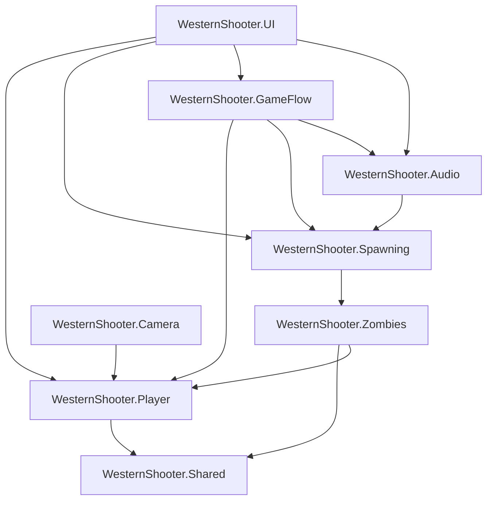

**English** · [Español](README.es.md)

# 🤠 WesternShooter


<!-- TODO: add platform and license badges once decided -->

**A third-person western shooter prototype built to explore interactive audio in Unity.**

<!-- TODO: replace with a real gameplay GIF -->


<!-- TODO: uncomment once the itch.io page exists
[**▶ Play / ⬇ Download on itch.io**](https://emiliano-bazan-zapata.itch.io/...)
-->

---

## About the game

The player explores a stylized western town, enters a wanted zone and fights zombies with a revolver. Victory comes after 3 kills; defeat, when health reaches zero.

The gameplay loop is deliberately compact. Its job is to drive the project's main goal: an audio mix that reacts to what happens in the game, with adaptive music, mixer snapshots, spatial ambience and voice cues.

After the audio work, the codebase went through a modular refactor into eight focused modules with compiler-enforced boundaries.

## Features

**Gameplay**

- Third-person, camera-relative movement with run, aim and shoulder swap.
- Aim-dependent revolver combat with physical projectiles.
- NavMesh zombies with chase, attack and death states.
- Trigger-activated spawning with population and respawn management.
- HUD for health and kills, plus main menu, pause, options, victory and defeat screens.

**Audio**

- Audio Mixer with independent Music, SFX, Voice and Ambience groups, each with its own volume slider.
- Mixer snapshots driven by gameplay: exploration, combat and character voice.
- Adaptive music with crossfades between exploration and combat, and dedicated victory and defeat tracks.
- Location-based voice cues for the bank, hotel, sheriff, saloon and other buildings.
- Spatial footsteps, ambience, a timed church bell and a train with steam bursts.

## Controls

| Action        | Keyboard / Mouse         | Gamepad                    |
| ------------- | ------------------------ | -------------------------- |
| Move          | `W` `A` `S` `D`          | Left stick                 |
| Look          | Mouse                    | Right stick                |
| Run           | `Shift`                  | Left stick press           |
| Aim           | Hold right mouse button  | Hold left trigger          |
| Shoot         | Left mouse button, aiming | Right trigger, aiming     |
| Shoulder swap | `Q`                      | Right stick press          |
| Pause         | `Esc`                    | —                          |

## Technical highlights

- **Gameplay-driven mix:** trigger volumes switch between the `PeacefulTown` and `Wanted` snapshots, and entering the wanted zone also starts the zombie spawner.
- **Reference-counted voice snapshot:** each voice cue acquires a `CharacterVoice` request and releases it when it finishes, so overlapping cues never restore the gameplay mix too early.
- **Adaptive music:** coroutine crossfades between exploration and combat music; a new crossfade cancels the previous one.
- **Modular monolith:** eight `.asmdef` modules under the `WesternShooter.*` namespace, with an acyclic dependency graph enforced by the compiler.
- **Events for facts, calls for commands:** health changes, deaths and kill totals are events; applying damage or starting the spawner are direct calls.
- **Runtime models outside MonoBehaviours:** `PlayerHealthModel`, `ZombieHealthModel` and `ZombieKillProgress` hold state apart from scene lifecycle code.
- **State machines** for player movement and zombie behaviour.

## Interactive audio

`GameAudioManager` is the scene-level entry point. It creates and coordinates focused controllers for mixer volume, gameplay snapshots, adaptive music and pausing non-music audio.

### Mixer groups

| Group      | Content                                                |
| ---------- | ------------------------------------------------------ |
| `Master`   | Root output and overall level                          |
| `Music`    | Exploration, combat, victory and defeat music          |
| `SFX`      | Weapons, footsteps, attacks, deaths and world effects  |
| `Voice`    | Location-based player voice cues                       |
| `Ambience` | Environmental beds and world atmosphere                |

Each group exposes a volume parameter. `AudioMixerController` converts the options menu's linear values to decibels.

### Snapshots and voice

| Snapshot         | When it is active                                   |
| ---------------- | --------------------------------------------------- |
| `PeacefulTown`   | Exploration; applied automatically when the level loads |
| `Wanted`         | After entering the wanted zone                      |
| `CharacterVoice` | While at least one voice cue is playing             |

When a voice cue plays:

1. It acquires a `CharacterVoice` snapshot request.
2. Playback is monitored until the AudioSource finishes.
3. The request is released on completion, disable or destroy.
4. When the last request ends, the snapshot that was active before (peaceful or wanted) is restored.

## Architecture

The game is one Unity application split into eight modules. Arrows point from the module that references to the module referenced.



| Module                    | Responsibility                                                              |
| ------------------------- | --------------------------------------------------------------------------- |
| `WesternShooter.Shared`   | Combat contract and shared projectile                                       |
| `WesternShooter.Player`   | Input, movement, health, revolver, animation, footsteps and movement states |
| `WesternShooter.Zombies`  | Health, targeting, NavMesh navigation, attacks, audio and enemy states      |
| `WesternShooter.Spawning` | Population, spawn activation, respawn queue and kill progress               |
| `WesternShooter.Audio`    | Mixer, snapshots, adaptive music, voice, ambience and audio triggers        |
| `WesternShooter.Camera`   | Third-person follow, aim profiles, shoulder swap and obstruction handling   |
| `WesternShooter.GameFlow` | In-game, pause, options, victory and defeat states                          |
| `WesternShooter.UI`       | HUD, main menu flow and audio options                                       |

<details>
<summary><b>Project structure</b></summary>

```text
Assets/
└── Scripts/
    ├── Audio/
    ├── Camera/
    ├── GameFlow/
    ├── Player/
    │   ├── Combat/
    │   ├── Health/
    │   ├── Input/
    │   ├── Movement/
    │   ├── Presentation/
    │   └── StateMachine/
    ├── Shared/
    ├── Spawning/
    │   ├── Progression/
    │   └── Spawner/
    ├── UI/
    └── Zombies/
        ├── Combat/
        ├── Health/
        ├── Navigation/
        ├── Presentation/
        ├── StateMachine/
        └── Targeting/
```

Each top-level module folder contains its own `.asmdef`.

</details>

<details>
<summary><b>Refactor history</b></summary>

The modular structure came from a deliberate refactor that:

- split player input, movement, health, combat, animation and footsteps;
- split zombie health, targeting, navigation, combat, audio and states;
- separated spawn management from kill progress;
- centralized pause, victory, defeat and cursor handling in GameFlow;
- made the HUD observe gameplay events instead of polling;
- split the mixer, snapshot, music, voice, pause and ambience responsibilities;
- standardized namespaces under `WesternShooter.*` and added the assembly definitions.

The full plan is in [`WesternShooter_Modular_Refactor_Plan.md`](WesternShooter/WesternShooter_Modular_Refactor_Plan.md).

</details>

## Testing

The game is tested manually in Play Mode: movement, aiming, shooting, spawning, HUD updates, pause and options, victory and defeat, and every audio transition.

## Getting started

### Requirements

- Unity Editor **6000.0.72f1**
- The third-party art and UI packs listed in [Credits](#credits-and-third-party-assets), which are not included in this repository

### Run locally

```bash
git clone https://github.com/EmilianoBazanZapata/WesternShooter.git
```

1. Import the third-party packs into `Assets/Packages/`.
2. In Unity Hub, choose **Add project from disk** and select the `WesternShooter/` folder.
3. Open it with Unity **6000.0.72f1** and let it restore packages.
4. Open the `MainMenu` scene and press **Play**.

<!-- TODO: move MainMenu.unity and Level.unity to Assets/Scenes/ and commit them; they currently live inside the ignored Assets/Packages/ folder -->

## Build

| Index | Scene      | Role                       |
| ----- | ---------- | -------------------------- |
| 0     | `MainMenu` | Main menu and controls     |
| 1     | `Level`    | Gameplay and audio demo    |

Open **File > Build Profiles**, check that both scenes are enabled in that order, choose a desktop target and press **Build**.

## Current scope and next steps

WesternShooter is an academic prototype: the playable loop is short by design and ends after 3 kills. Next steps:

- Edit Mode tests for `PlayerHealthModel`, `ZombieHealthModel` and `ZombieKillProgress`.
- A gamepad binding for pause.
- A playable build on itch.io.

## Credits and third-party assets

Gameplay code, audio integration and the modular architecture are by Emiliano Bazán-Zapata.

| Content                              | Author                              | In this repo |
| ------------------------------------ | ----------------------------------- | ------------ |
| POLYGON Western, POLYGON Generic     | Synty Studios                       | No           |
| Wooden UI Kit                        | ShroomieStudio (Kristina Mironenko) | No           |
| Fantasy Wooden GUI Free              | <!-- TODO: author -->               | No           |
| "The Saloon on the Edge of the World" | Steven Lynn                        | Yes          |
| Other music, SFX and voice clips     | <!-- TODO: sources -->              | Yes          |

Third-party assets belong to their creators and are used under their own licenses.

## License

<!-- TODO: add LICENSE file and state the chosen license here -->

---

**Binary Suns Studio** · [Website](https://binarysunsstudio.com.ar) · [itch.io](https://emiliano-bazan-zapata.itch.io) · [LinkedIn](https://www.linkedin.com/in/emiliano-bazán-zapata-18705721a)
