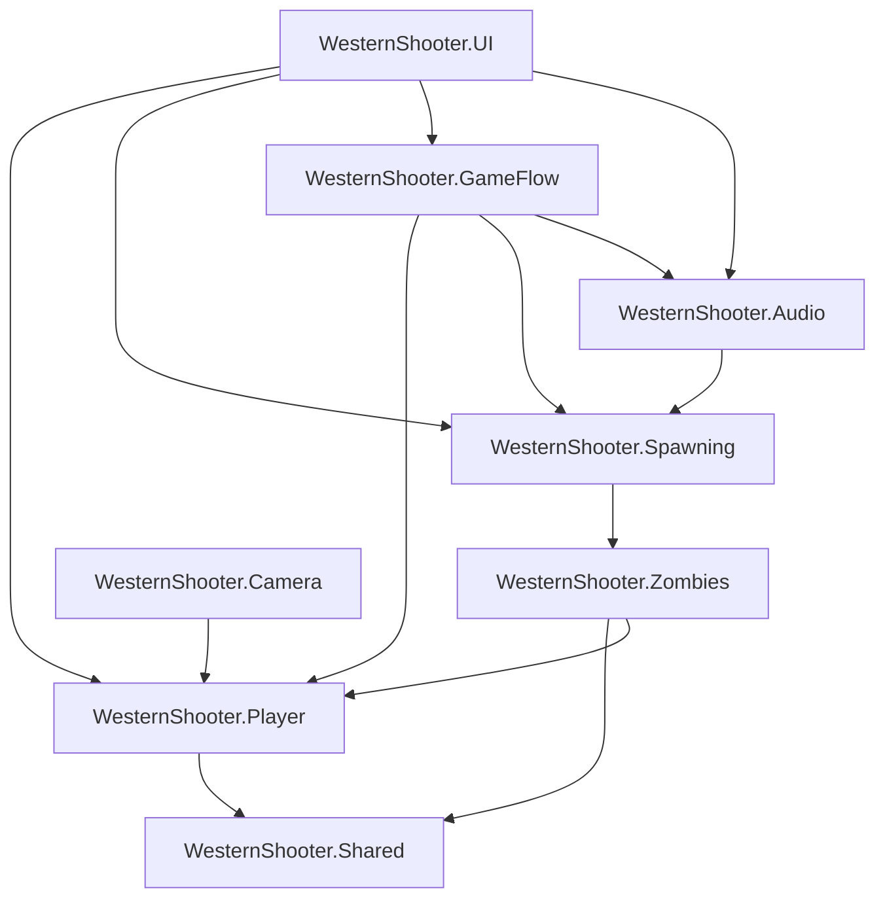

# WesternShooter

WesternShooter is an interactive audio-focused western shooter prototype built with Unity. Its compact third-person gameplay loop—exploration, aiming, shooting, zombie combat, and short victory/defeat conditions—provides a practical setting for adaptive music, mixer snapshots, spatial ambience, voice cues, and gameplay-driven sound.

## Overview

The project places the player in a stylized western environment populated by hostile zombies. The player can explore the level, enter a wanted/combat area, fight enemies with a revolver, and follow health and kill progress through an in-game HUD.

The configured experience is deliberately short: victory is raised after **3 zombie kills**, while defeat occurs when player health reaches zero. The gameplay scope supports the project's primary academic goal—designing and integrating interactive audio systems—rather than attempting to provide a full commercial shooter.

Key systems include:

- third-person, camera-relative player movement;
- aim-dependent revolver combat and physical projectiles;
- NavMesh-driven zombie chase, attack, and death states;
- triggered spawning with population and respawn management;
- event-driven health, kill, aim, victory, and defeat presentation;
- adaptive music and Audio Mixer snapshots tied to gameplay state;
- spatial footsteps, environmental ambience, world sounds, and location voice cues;
- main menu, pause, options, victory, and defeat flows.

## Project Goals

WesternShooter was developed to explore how game state and world interaction can shape an audio mix. Its main goals are to:

- connect gameplay transitions to music and mixer states;
- route music, effects, voice, and ambience through independent mixer categories;
- coordinate peaceful, wanted, and character-voice listening contexts;
- combine continuous ambience with localized and timed world sounds;
- integrate player and zombie feedback through footsteps, attacks, gunfire, and death audio;
- keep gameplay and audio responsibilities understandable as the prototype evolves.

The codebase later received a deliberate modular refactor. Player, zombie, spawning, audio, camera, game-flow, and UI responsibilities now live in focused modules under the `WesternShooter.*` namespace and are separated by Assembly Definition files.

## Gameplay

The implemented gameplay loop is:

1. Start from the `MainMenu` scene and load the gameplay scene asynchronously.
2. Move through the western environment while the peaceful audio state is active.
3. Enter the configured wanted trigger, which changes the audio state and starts the zombie spawner.
4. Aim and fire the revolver at NavMesh-driven zombies.
5. Track player health and total kills through the HUD.
6. Reach the configured threshold of 3 kills to trigger victory music and the victory state.
7. If zombie attacks reduce player health to zero first, trigger defeat music and the defeat state.

The pause, options, victory, and defeat states pause gameplay through `Time.timeScale`, update the cursor, switch the relevant UI panels, and pause non-music audio that was playing when the state changed.

## Controls

The active gameplay implementation reads devices through Unity's Input System. Shooting requires the player to be aiming.

| Action | Keyboard / Mouse | Gamepad |
|---|---|---|
| Move | `W`, `A`, `S`, `D` | Left stick |
| Look | Mouse movement | Right stick |
| Run | Left or right `Shift` | Press left stick |
| Aim | Hold right mouse button | Hold left trigger |
| Shoot | Left mouse button while aiming | Right trigger while aiming |
| Shoulder swap | `Q` | Press right stick |
| Pause / resume | `Esc` | Not implemented in the gameplay reader |

`Esc` also returns from the controls panel to the main menu panel. The repository includes an Input Actions asset with `Player` and `UI` maps; the current gameplay reader directly consumes Input System keyboard, mouse, and gamepad devices.

# Interactive Audio

Interactive audio is the central technical focus of WesternShooter. The implementation combines an Audio Mixer, snapshots, multiple music sources, spatial AudioSources, world triggers, and focused runtime controllers.

`GameAudioManager` is the scene-level entry point. It creates and coordinates dedicated controller objects for mixer volume, gameplay snapshots, adaptive music, and non-music pause behavior. This keeps the public integration surface small while separating the underlying responsibilities.

## Audio Mixer

The project contains `Assets/Audio/Documentation/GameAudioMixer.mixer` with the following routing groups:

| Mixer group | Responsibility |
|---|---|
| `Master` | Root output and overall level control |
| `Music` | Peaceful, wanted, victory, and defeat music |
| `SFX` | Weapons, footsteps, attacks, deaths, and world effects |
| `Voice` | Location-based player voice cues |
| `Ambience` | Environmental beds and world atmosphere |

The mixer exposes `MasterVolume`, `MusicVolume`, `SFXVolume`, `VoiceVolume`, and `AmbienceVolume`. `OptionsMenuController` maps UI volume callbacks to these parameters through `AudioMixerController`, which converts normalized linear values to decibels.

This routing allows each category to be adjusted independently without changing the individual AudioSource setup.

## Gameplay Audio States

Three authored snapshots are central to the runtime mix:

- **PeacefulTown** represents the exploration state.
- **Wanted** represents active combat or danger.
- **CharacterVoice** temporarily shapes the mix around spoken location cues.

`GameplaySnapshotTrigger` changes between peaceful and wanted states when the player enters configured trigger volumes. The wanted trigger in the gameplay scene is also configured to start zombie spawning. On loading the `Level` scene, `GameAudioManager` applies the peaceful state automatically.

`GameplaySnapshotController` remembers whether the current gameplay state is peaceful or wanted. While character voice is active, it temporarily prioritizes the voice snapshot; after all voice requests have ended, it restores the remembered gameplay snapshot.

## Adaptive Music

`AdaptiveMusicController` manages separate AudioSources for peaceful, wanted, victory, and defeat music.

- Peaceful and wanted changes use a coroutine-based crossfade.
- A new crossfade cancels the previous active transition before starting.
- Victory and defeat stop the exploration/combat sources and play the appropriate outcome source from the beginning.
- Active crossfades are stopped during manager destruction.

The gameplay scene currently references the available saloon/exploration music, `BattleMusic.wav`, `VictoryGame.wav`, and `LoseGame.wav` assets through its configured AudioSources.

## Voice System

`PlayerVoiceAudioController` stores named voice cues with optional randomized clip sets and per-cue cooldowns. Nine `ProximityVoiceTrigger` components in the gameplay scene request cues associated with western locations such as the bank, hotel, sheriff, shop, train, barber shop, and saloon.

Voice playback participates in the mixer state:

1. Starting a cue acquires a character-voice snapshot request.
2. Playback is monitored until the AudioSource finishes.
3. The request is released on completion, disable, or destruction.
4. Snapshot requests are counted so overlapping request lifetimes do not restore the gameplay mix too early.
5. When the final request ends, the peaceful or wanted snapshot that was active beforehand is restored.

This lifecycle makes voice cues part of the interactive mix rather than isolated sound effects.

## Ambience and World Audio

The gameplay scene references the project's complete first-party audio set, including:

- stereo desert ambience;
- saloon music/ambience;
- a timed church bell that rings once on start and then at a configurable interval;
- a looping train engine with separate timed steam bursts;
- player and zombie footsteps with clip variation;
- revolver, zombie attack, zombie death, victory, and defeat sounds;
- one-shot proximity voice cues for named locations;
- trigger-driven transitions between peaceful and wanted snapshots.

Player footsteps are spatialized and vary clip selection and pitch. Zombie footsteps are driven by navigation velocity and state, while zombie attack and death sounds are coordinated by the zombie state machine.

# Architecture

WesternShooter uses a pragmatic **modular-monolith** structure: the game remains one Unity application and one build, while first-party code is divided into focused gameplay modules. Assembly Definition files enforce allowed compile-time references, namespaces communicate ownership, and the project uses both events and direct calls according to the interaction being represented.

- Events communicate facts such as health changes, death, aim changes, kill totals, victory thresholds, and game-state changes.
- Direct method calls express commands such as starting spawning, applying damage, changing an audio state, pausing, or returning to the menu.

## Module Overview

| Module | Responsibility |
|---|---|
| `WesternShooter.Shared` | Cross-module combat contract and shared projectile implementation |
| `WesternShooter.Player` | Input, movement, health, revolver combat, animation, footsteps, and player movement states |
| `WesternShooter.Zombies` | Enemy health, target resolution, NavMesh navigation, attack logic, audio presentation, and enemy states |
| `WesternShooter.Spawning` | Zombie population management, spawn activation, respawn queues, and kill progression |
| `WesternShooter.Audio` | Mixer control, snapshots, adaptive music, voice, ambience, world audio, and audio triggers |
| `WesternShooter.Camera` | Third-person follow, aim profiles, shoulder swapping, smoothing, and obstruction handling |
| `WesternShooter.GameFlow` | In-game, pause, options, victory, defeat, cursor, and scene-return coordination |
| `WesternShooter.UI` | HUD, asynchronous main-menu flow, controls panel, and audio options callbacks |

## Assembly Dependency Graph

The following graph reflects the current `.asmdef` references. Arrows point from the consuming assembly to the first-party assembly it references.



The asmdefs provide explicit module boundaries, compiler-enforced references, clearer ownership, and useful seams for future tests. They also make accidental dependency cycles easier to detect.

## Player Module

The Player module is organized by capability:

- `PlayerInputReader` polls keyboard, mouse, and gamepad input once per frame and exposes movement, look, run, aim, shoot, and shoulder-swap state.
- `PlayerMotor` owns `CharacterController` movement, camera-relative direction, gravity, grounding, and rotation.
- `PlayerHealthModel` stores health outside the MonoBehaviour lifecycle and raises health/death events.
- `PlayerMovementStateMachine` coordinates idle, walk, and run states; aiming, death, gravity, animation, and footsteps remain integrated through focused collaborators.
- `PlayerRevolverShooter` requires aim input, raycasts from the camera to choose a target point, instantiates the projectile at the muzzle, ignores owner collisions, and plays the shot source.
- `PlayerAnimationController` translates gameplay state into hashed Animator parameters.
- `PlayerFootstepAudio` selects step clips, varies pitch, and uses a spatial AudioSource.

The state machine coordinates the feature without owning the low-level implementation of every responsibility.

## Zombie Module

The Zombies module uses a small finite state machine with three implemented states:

- **Chase** resumes NavMesh movement, updates the destination, enables movement presentation, and transitions into attack range.
- **Attack** stops navigation, turns toward the target, and applies cooldown-controlled damage.
- **Dead** stops movement, disables footsteps, triggers death animation/audio, and disables the NavMeshAgent.

Supporting classes keep individual concerns focused:

- `ZombieHealthModel` manages health and death state.
- `ZombieTarget` owns the current target and can resolve the player as a fallback.
- `ZombieNavigation` wraps `NavMeshAgent` movement and rotation operations.
- `ZombieAttackController` checks range, coordinates animation/audio, and applies damage through `IDamageable`.
- `ZombieAudioController` handles footsteps, attack playback, and death playback.
- `ZombieStateMachine` is the Unity-facing coordinator and publishes `ZombieDied` for spawning/progression.

## Spawning and Progression

`ZombieSpawnerManager` owns the live population, spawn points, queued spawn requests, delayed respawns, and subscriptions to individual zombie death events. Spawning is disabled on scene start in the configured level and begins when the wanted gameplay trigger is entered.

`ZombieKillProgress` is the source of truth for total kills and the victory threshold. It is a separate runtime model that publishes:

- `TotalKilledChanged` for the HUD;
- `VictoryThresholdReached` for GameFlow.

The configured `Level` scene sets the victory threshold to **3**. Keeping progression as its own model prevents the HUD or GameManager from calculating kills independently.

## Game Flow

`GameManager` coordinates the high-level `InGame`, `Pause`, `Options`, `Victory`, and `Defeat` states.

It subscribes to player death and zombie victory progression, then coordinates:

- the appropriate gameplay UI panel;
- `Time.timeScale`;
- cursor visibility and lock state;
- non-music pause/resume behavior;
- victory or defeat music;
- returning to the `MainMenu` scene.

Gameplay modules report meaningful events; GameFlow decides how those events affect the overall session.

## UI

The UI module uses Unity uGUI and observes existing gameplay state instead of duplicating it.

- `InGameHudController` displays player health and total kills, updates the crosshair from aim/death/game-state events, and safely manages event subscriptions across enable/disable cycles.
- `MainMenuFlowController` switches between menu and controls panels and loads `Level` asynchronously.
- `OptionsMenuController` forwards category-volume changes and snapshot preview commands to `GameAudioManager`.

The current kill label is normalized to `Killed`, and the value is updated from `ZombieKillProgress` whenever a zombie death is registered.

## Camera

`ThirdPersonCameraFollow` provides a custom third-person camera with:

- separate exploration and aim distance, height, shoulder offset, sensitivity, and field-of-view profiles;
- smooth position, profile, and field-of-view transitions;
- right/left shoulder swapping;
- target-relative look input from `PlayerInputReader`;
- sphere-cast obstruction handling that ignores colliders belonging to the player target.

# Project Structure

The first-party runtime code is organized as follows:

```text
Assets/
└── Scripts/
    ├── Audio/
    ├── Camera/
    ├── GameFlow/
    ├── Player/
    │   ├── Combat/
    │   ├── Health/
    │   ├── Input/
    │   ├── Movement/
    │   ├── Presentation/
    │   └── StateMachine/
    │       └── States/
    ├── Shared/
    │   └── Combat/
    ├── Spawning/
    │   ├── Progression/
    │   └── Spawner/
    ├── UI/
    └── Zombies/
        ├── Combat/
        ├── Health/
        ├── Navigation/
        ├── Presentation/
        ├── StateMachine/
        │   └── States/
        └── Targeting/
```

Each top-level script module contains its corresponding runtime `.asmdef`.

# Technologies

| Area | Technology | Repository version | Purpose |
|---|---|---:|---|
| Game engine | Unity 6 | `6000.0.72f1` | Editor, runtime, scenes, physics, animation, audio, and UI |
| Language | C# | Managed by Unity | First-party gameplay and audio code |
| Rendering | Universal Render Pipeline | `17.0.4` | Rendering pipeline and renderer configuration |
| Input | Unity Input System | `1.19.0` | Keyboard, mouse, gamepad, and UI input support |
| Navigation | AI Navigation | `2.0.12` | NavMesh-based zombie navigation |
| UI | Unity UI (uGUI) | `2.0.0` | HUD, menus, sliders, and state panels |
| Audio | Unity Audio Mixer and AudioSource | Unity engine modules | Routing, exposed volumes, snapshots, music, SFX, voice, and ambience |
| Modularity | Assembly Definition files | 8 runtime assemblies | Compiler-enforced first-party module references |

# Requirements

- Unity Hub, or another supported way to install and launch the required editor.
- Unity Editor `6000.0.72f1`.
- Git for cloning the repository.
- A keyboard and mouse or compatible gamepad for the documented gameplay controls.

No hardware minimum specification or fully validated platform matrix is included in the repository.

# Getting Started

1. Clone the repository:

   ```bash
   git clone <repository-url>
   ```

2. In Unity Hub, choose **Add project from disk** and select the directory containing `Assets`, `Packages`, and `ProjectSettings`.
3. Open the project with Unity `6000.0.72f1`.
4. Allow Unity to restore packages and finish importing assets.
5. Open `Assets/Packages/Synty/PolygonWestern/Scenes/MainMenu.unity`.
6. Enter Play Mode and select the start option from the main menu.

The menu loads the gameplay scene asynchronously. To inspect gameplay directly, open `Assets/Packages/Synty/PolygonWestern/Scenes/Level.unity` and enter Play Mode.

# Build

The enabled scenes, in build order, are:

| Index | Scene | Role |
|---:|---|---|
| 0 | `Assets/Packages/Synty/PolygonWestern/Scenes/MainMenu.unity` | Starting menu and controls flow |
| 1 | `Assets/Packages/Synty/PolygonWestern/Scenes/Level.unity` | Gameplay and interactive audio demonstration |

To create a local build:

1. Open the project in the required Unity version.
2. Open **File > Build Profiles**.
3. Confirm that `MainMenu` and `Level` remain enabled in the order above.
4. Select an available local desktop target and configure its output location.
5. Choose **Build** or **Build and Run**.

The repository does not include evidence of a validated release build or supported-platform certification, so platform compatibility should be verified locally.

# Design Decisions

## Modular Monolith

The project is small enough to remain one Unity application, but large enough to benefit from visible ownership. Feature modules provide that separation without introducing service infrastructure or framework overhead that would be disproportionate for an academic prototype.

## Events and Commands

Events are used for completed facts that observers may react to: health changes, deaths, aim state, kill totals, victory thresholds, and game-state changes. Direct calls remain explicit for commands such as applying damage, starting the spawner, selecting an audio state, and changing menus.

## Runtime Models

`PlayerHealthModel`, `ZombieHealthModel`, and `ZombieKillProgress` hold focused runtime state outside their coordinating MonoBehaviours. This separates rules and progression data from scene lifecycle code and provides straightforward seams for future Edit Mode tests.

## Assembly Definitions

Eight runtime asmdefs map directly to the project modules. Their references enforce the dependency graph shown above and prevent unrelated modules from accessing one another accidentally.

# Refactor History

The current structure is the result of a deliberate modular refactoring pass that:

- separated player input, movement, health, combat, animation, and footsteps;
- separated zombie health, targeting, navigation, combat, audio, and state behavior;
- separated spawn population management from kill progression;
- centralized pause, victory, defeat, cursor, and session-level UI coordination;
- changed HUD communication to observe gameplay events;
- split mixer, snapshot, adaptive-music, voice, pause, and environmental-audio responsibilities;
- organized first-party scripts by gameplay module;
- standardized namespaces under `WesternShooter.*`;
- introduced Assembly Definition files with explicit references.

The goal of the refactor was maintainability and clearer responsibility ownership while preserving the intentionally compact gameplay experience.

# Known Scope and Limitations

- WesternShooter is an academic interactive-audio prototype, not a complete commercial shooter.
- The playable loop is intentionally short and currently ends in victory after 3 kills.
- Gameplay systems exist primarily to drive and demonstrate audio behavior.
- Keyboard/mouse and gamepad gameplay input are implemented, but pause currently has only a keyboard binding.
- The repository does not provide a documented hardware specification or verified release-platform matrix.
- No gameplay screenshot, GIF, or trailer is currently included as repository media.

# Testing

No first-party Edit Mode or Play Mode test assemblies are currently present. The Unity Test Framework package is installed, but the repository does not claim automated test coverage.

Current validation is performed through:

- Unity script compilation;
- manual Play Mode checks;
- regression testing of movement, aiming, shooting, spawning, HUD updates, pause/options flow, victory/defeat, and audio transitions.

Natural future automated test candidates include the pure health/progression models in Edit Mode and scene, physics, lifecycle, and audio-state integration in Play Mode.

# Third-Party Assets and Credits

First-party gameplay and audio integration code lives under `Assets/Scripts`. The repository also contains Unity packages and imported third-party visual, UI, font, and audio content.

| Content | Repository evidence | Attribution / license status |
|---|---|---|
| POLYGON Western and POLYGON Generic content | `Assets/Packages/Synty/` | Synty assets; no standalone Synty license file was found in the repository. Use remains subject to the applicable source license. |
| Wooden UI Kit | `Assets/Packages/WoodenUI_Kit/` | Version 1.0 by ShroomieStudio (Kristina Mironenko). The included license refers to the Unity Asset Store EULA and prohibits redistribution/resale of the asset itself. |
| Fantasy Wooden GUI Free | `Assets/Packages/Fantasy Wooden GUI  Free/` | Imported third-party UI content; no accompanying license or author document was found in that folder. |
| TextMesh Pro resources | `Assets/Packages/TextMesh Pro/` | Includes font OFL files and EmojiOne attribution notices in the repository. |
| Saloon music file | `Assets/Audio/Ambience/Exterior/Steven Lynn - The Saloon on the Edge of the World - Forgotten Music.wav` | The filename credits Steven Lynn; no separate license document for this recording was found. |
| Other audio clips | `Assets/Audio/` | The repository contains ambience, music, SFX, and voice recordings, but does not include comprehensive per-clip attribution or license documentation. |
| Unity registry packages | `Packages/manifest.json` | Supplied under their respective Unity/package terms. |

Third-party assets remain the property of their respective creators and are subject to their respective licenses. This README does not grant redistribution rights for imported asset-store or audio content.

# License

No root project license is currently included in this repository. The absence of a project license does not replace or override the separate terms attached to Unity packages and third-party assets.

